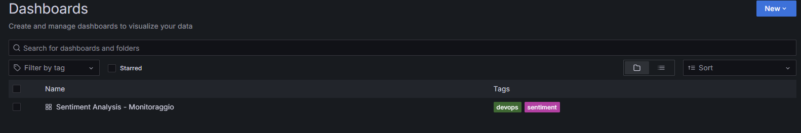
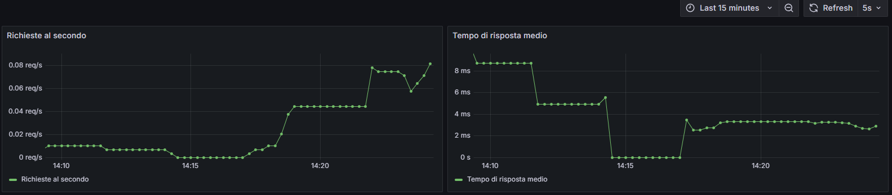
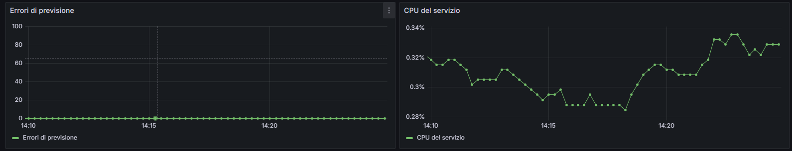
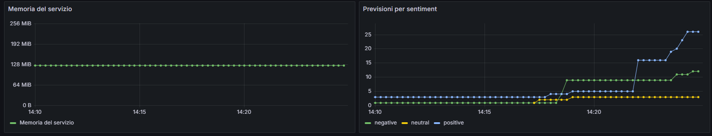
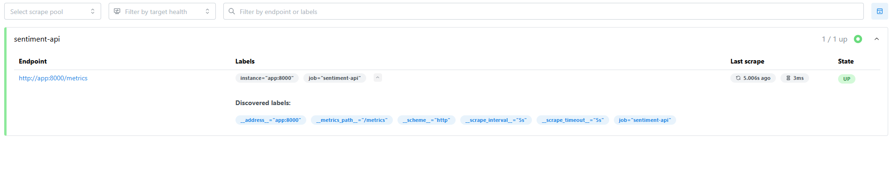

# Progetto DevOps - Sentiment Analysis

## Descrizione

Il progetto consiste nella messa in produzione di un modello di Sentiment Analysis già addestrato, fornito durante il corso.

Il modello analizza recensioni scritte in inglese e restituisce uno dei seguenti risultati:

- **positive**: recensione positiva
- **negative**: recensione negativa
- **neutral**: recensione neutra

Insieme al risultato viene restituito anche un valore di probabilità.

Per realizzare il progetto ho utilizzato FastAPI, Docker, Jenkins, Prometheus e Grafana.

## Struttura del progetto

I file principali sono:

- `app.py`: contiene le API del servizio.
- `sentiment_analysis_model.pkl`: modello già addestrato.
- `requirements.txt`: librerie Python utilizzate.
- `Dockerfile`: crea l'immagine Docker.
- `docker-compose.yml`: avvia i container.
- `Jenkinsfile`: contiene la pipeline CI/CD.
- `tests/`: contiene i test automatici.
- `monitoring/`: contiene le configurazioni di Prometheus e Grafana.
- `jenkins-local/`: contiene i file per avviare Jenkins in locale.
- `screenshots/`: contiene le immagini del monitoraggio e di Jenkins.

## Architettura del progetto

Il progetto utilizza GitHub per il versionamento del codice e Jenkins per automatizzare le operazioni di build, test e deploy.

L'applicazione viene eseguita tramite Docker, mentre Prometheus e Grafana vengono utilizzati per il monitoraggio.

```text
GitHub
   |
Jenkins
Build -> Test -> Deploy
   |
Docker
   |
FastAPI -> Modello Sentiment Analysis
   |
/metrics
   |
Prometheus
   |
Grafana
```

## Avvio del progetto

Per avviare il progetto è necessario avere Docker installato.

Aprire il terminale nella cartella del progetto ed eseguire:

```bash
docker compose up -d --build
```

Una volta avviati i container, i servizi sono disponibili ai seguenti indirizzi:

- **FastAPI:** http://localhost:8000/docs
- **Prometheus:** http://localhost:9090/targets
- **Grafana:** http://localhost:3000

Per verificare i container:

```bash
docker compose ps
```

Per controllare i log dell'applicazione:

```bash
docker compose logs app
```

Per riavviare il servizio:

```bash
docker compose restart app
```

Per fermare tutti i container:

```bash
docker compose down
```

## API REST

Il servizio contiene due endpoint.

### POST /predict

Riceve una recensione in inglese e restituisce il sentiment individuato dal modello.

Esempio di richiesta:

```json
{
  "review": "I hate it. Terrible product."
}
```

Esempio di risposta:

```json
{
  "sentiment": "negative",
  "confidence": 0.6324
}
```

### GET /metrics

Restituisce le metriche del servizio, che vengono raccolte da Prometheus.

## Test automatici

Sono stati creati test unitari e di integrazione per verificare il funzionamento delle API e del modello.

Per eseguire i test:

```bash
docker compose run --rm --no-deps app python -m pytest -q
```

Durante le prove in locale sono stati superati tutti e 7 i test.

## Pipeline Jenkins

Per automatizzare build, test e deploy del servizio viene utilizzato Jenkins.

La pipeline è definita nel file `Jenkinsfile` e prevede tre fasi:

1. **Build:** crea l'immagine Docker.
2. **Test:** esegue i test automatici.
3. **Deploy:** aggiorna il servizio se i test vengono superati.

Jenkins controlla periodicamente GitHub, circa ogni 2 minuti, per verificare la presenza di nuovi commit.

Quando viene rilevato un nuovo commit, la pipeline parte automaticamente.

### Avvio di Jenkins

Per avviare Jenkins in locale:

```bash
docker compose -f jenkins-local/docker-compose.yml up -d --build
```

Jenkins è disponibile all'indirizzo:

http://localhost:8080

### Configurazione della pipeline

Per collegare Jenkins al progetto:

1. Creare un nuovo elemento di tipo **Pipeline**.
2. Selezionare **Pipeline script from SCM**.
3. Selezionare **Git** e inserire l'indirizzo del repository.
4. Impostare il branch `main`.
5. Indicare `Jenkinsfile` come percorso dello script.
6. Salvare e avviare la prima esecuzione.

### Notifiche email

La pipeline prevede l'invio di notifiche email in caso di successo o errore.

Per utilizzare le notifiche è necessario configurare il server SMTP in Jenkins.

Il destinatario può essere inserito nel parametro `EMAIL_NOTIFICHE` oppure impostato nella variabile globale `EMAIL_DESTINATARIO`.

In questo modo le notifiche vengono inviate anche quando la pipeline parte automaticamente.

### Verifica della pipeline

La pipeline è stata verificata in locale.

Jenkins ha rilevato automaticamente un nuovo commit su GitHub ed eseguito correttamente tutte le fasi.

I 7 test sono stati superati e il container dell'applicazione è stato aggiornato.

È stato verificato anche l'invio automatico della notifica email di successo. La notifica in caso di errore è configurata nel Jenkinsfile.


## Monitoraggio

Per monitorare il servizio sono stati utilizzati Prometheus e Grafana.

Prometheus raccoglie le metriche dell'applicazione, mentre Grafana permette di visualizzarle attraverso dei grafici.

Le metriche monitorate sono:

- Richieste al secondo
- Tempo medio di risposta
- Errori di previsione
- Utilizzo della CPU
- Utilizzo della memoria
- Numero di previsioni per sentiment

Gli errori di previsione indicano gli errori tecnici durante l'elaborazione, non le recensioni classificate in modo sbagliato.

La configurazione della dashboard si trova nel file `monitoring/grafana/dashboard.json`.

### Screenshot del monitoraggio

Di seguito sono riportati gli screenshot del monitoraggio effettuato in locale.

**Dashboard Grafana**



**Richieste e tempi di risposta**



**Errori e utilizzo CPU**



**Memoria e previsioni per sentiment**



**Monitoraggio Prometheus**



## Repository GitHub

Il repository pubblico del progetto è:

https://github.com/giuseppe12devops/sentiment-devops

Il repository contiene il codice, i file di configurazione e la documentazione del progetto.

## Conclusione

Con questo progetto ho utilizzato gli strumenti DevOps affrontati durante il corso per mettere in produzione un modello di Sentiment Analysis già addestrato.

Il servizio è stato realizzato con FastAPI e Docker, verificato tramite test automatici e monitorato con Prometheus e Grafana.

Con Jenkins sono state automatizzate le operazioni di build, test e deploy, insieme alle notifiche sul risultato della pipeline.